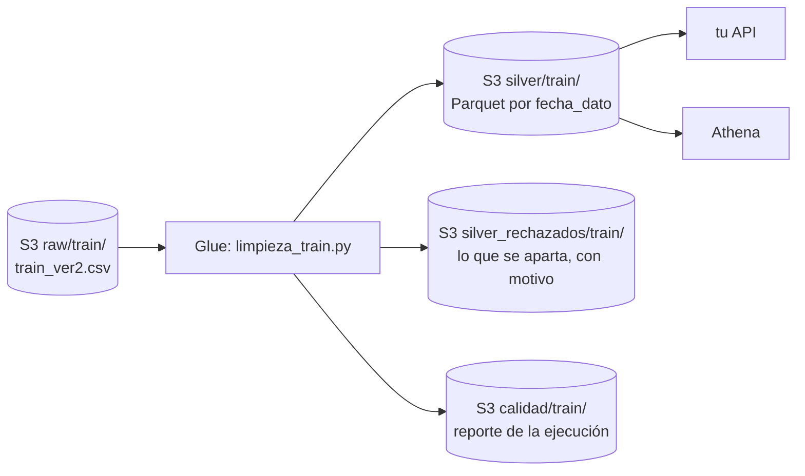

# Limpieza de train_ver2.csv: de bronze a silver

- [Limpieza de train_ver2.csv: de bronze a silver](#limpieza-de-train_ver2csv-de-bronze-a-silver)
  - [Resumen](#resumen)
  - [Qué hace la limpieza](#qué-hace-la-limpieza)
  - [Qué sale](#qué-sale)
  - [Resultados esperados](#resultados-esperados)
  - [Instalación en una cuenta de AWS](#instalación-en-una-cuenta-de-aws)
  - [Leer silver desde la API](#leer-silver-desde-la-api)
  - [Migrar a otro proyecto u otra cuenta](#migrar-a-otro-proyecto-u-otra-cuenta)
  - [Costo y tiempos](#costo-y-tiempos)
  - [Pruebas](#pruebas)
  - [Lo que esta limpieza no hace](#lo-que-esta-limpieza-no-hace)

---

## Resumen

Un trabajo de AWS Glue (PySpark) lee el archivo crudo `train_ver2.csv` de S3 (13 647 309 filas, 2.3 GB, 17 cortes mensuales de enero de 2015 a mayo de 2016) y escribe la capa **silver** en Parquet, lista para que una API la consulte. No hay ningún otro conjunto de datos ni ningún join.

**La regla de la limpieza: arreglar y rescatar, nunca inventar ni rellenar.** No hay medianas, promedios, ceros por defecto ni etiquetas como `DESCONOCIDO`. Un dato que no existe queda vacío (`null`); un dato que solo estaba mal escrito se arregla; un dato que el mismo cliente tiene en otro mes se rescata, y la fila dice cuál.



| Carpeta | Contenido |
| --- | --- |
| [glue/](glue/) | `limpieza_train.py`, el trabajo de Glue, y sus pruebas |
| [terraform/](terraform/) | todo lo que se necesita en AWS: bucket, rol, trabajo de Glue, base de datos y tablas de Athena |
| [athena/](athena/) | las tablas en SQL (si no usas Terraform) y las consultas que verifican la limpieza |

---

## Qué hace la limpieza

Los datos se examinaron completos antes de escribir las reglas. Cada regla responde a algo que se encontró.

**1. Arregla el formato** (no cambia ningún dato)

| Regla | Por qué |
| --- | --- |
| Quita los espacios de cada valor (`" 35"` → `35`) | Las columnas numéricas vienen con espacios a la izquierda |
| `''` y `NA` pasan a `null` | El archivo escribe de tres formas distintas un dato que no existe |
| Asigna tipos: fechas, enteros, `renta` en decimal | Todo llega como texto |
| `indrel_1mes`: `1.0` → `1` | El mismo tipo de cliente viene escrito de dos formas (`1.0` en 9.1 M de filas y `1` en 4.4 M) |
| Los valores que no se pueden convertir quedan `null` y se cuentan | En este archivo son 0, pero el reporte lo comprueba cada vez |

**2. Invalida lo imposible** (queda `null`, y la fila lo dice en `campos_invalidados`)

| Regla | Filas | Por qué |
| --- | --- | --- |
| `age` fuera de 0 a 122 | 22 | Hay edades de 126, 127, 163 y 164 años. La cola de 100 a 117 años se conserva: son clientes reales que cumplen años mes a mes (por ejemplo, el 100305 pasa de 100 a 101) |
| `antiguedad` negativa | 38 | El archivo usa `-999999` como marca de "no hay dato" |

**3. Rescata con datos reales del mismo cliente** (la fila dice qué se rescató en `campos_rescatados`)

Un vacío se rellena con el valor del mismo cliente en otro mes, solo si es seguro:

- el último valor conocido antes y el primero conocido después son **el mismo**, o
- el cliente tiene **un único valor** en todos sus meses.

Si el cliente tuvo valores distintos y no se sabe cuál corresponde, el vacío se queda.

Solo se rescatan columnas que casi no cambian de un mes a otro: `ind_empleado`, `pais_residencia`, `sexo`, `fecha_alta`, `indresi`, `indext`, `indfall`, `canal_entrada`, `cod_prov`, `nomprov`, `segmento` y `tipodom`. **No** se rescatan:

- `tiprel_1mes`, `indrel_1mes` e `ind_actividad_cliente`, que son el estado del cliente en ese mes y sí cambian;
- `ult_fec_cli_1t` y `conyuemp`, donde el vacío significa "no aplica", no "falta";
- `age` y `antiguedad`, que cambian cada mes;
- `renta`: el vacío (2.7 M de filas) es permanente por cliente; ningún cliente tiene su renta en otro mes;
- los 24 productos: lo que tiene un cliente cambia cada mes.

**4. Aparta, sin borrar, los registros que no sirven** (van a `silver_rechazados/` con el motivo)

| Motivo | Cuándo | Filas |
| --- | --- | --- |
| `sin_identificador` | `ncodpers` o `fecha_dato` vacíos o ilegibles | 0 |
| `repetido_fecha_dato_ncodpers` | Más de un registro del mismo cliente en el mismo mes. Se queda el más completo | 0 |
| `sin_datos_del_cliente` | Después del rescate, el registro sigue sin `fecha_alta`: solo trae los productos | 26 685 |

Los 26 685 registros de `sin_datos_del_cliente` son de enero a junio de 2015 y de 7 031 clientes que nunca traen un dato propio. De los 27 734 que había, **1 049 se rescataron**: eran de clientes que sí tienen sus datos en otros meses. Esas 1 049 filas quedan en silver con los datos fijos del cliente recuperados y vacío todo lo que cambia mes a mes (edad, actividad, renta…). Se reconocen con `campos_rescatados LIKE '%fecha_alta%'`.

---

## Qué sale

**`silver/train/`**: Parquet con compresión snappy, una carpeta por mes (`fecha_dato=2015-01-28/` … `fecha_dato=2016-05-28/`), un archivo por mes y ordenado por `ncodpers` dentro de cada uno (así una búsqueda por cliente salta bloques de cada archivo).

Tiene las 48 columnas del archivo original, con su nombre y con tipos (`fecha_dato` como columna de partición), y dos más:

| Columna | Tipo | Contenido |
| --- | --- | --- |
| `campos_rescatados` | string | Las columnas que se rescataron en esa fila, separadas por comas (`canal_entrada,segmento`). `null` si ninguna |
| `campos_invalidados` | string | Las columnas que se dejaron en `null` por imposibles (`age`). `null` si ninguna |

No se quita ninguna columna del original.

**`silver_rechazados/train/`**: las mismas columnas, más `motivo`.

**`calidad/train/`**: una fila por métrica del reporte (`metrica`, `detalle`, `filas`): filas leídas, rechazadas por motivo, campos rescatados e invalidados, y los nulos que quedan en cada columna de silver. El trabajo también imprime el reporte en su log (`[limpieza] ...`).

---

## Resultados esperados

Con `train_ver2.csv` completo. Se calcularon con DuckDB, una implementación independiente de las reglas, y la de Spark se comparó contra ella sobre una muestra de 271 237 filas (los conteos de rescate coinciden en las 12 columnas).

| | Filas |
| --- | --- |
| Leídas | 13 647 309 |
| En silver | **13 620 624** (949 614 clientes) |
| Rechazadas (`sin_datos_del_cliente`) | 26 685 |
| Con algún campo rescatado | 129 675 |
| Rescatadas: `canal_entrada` | 125 541 |
| Rescatadas: `segmento` | 121 387 |
| Rescatadas: `cod_prov` y `nomprov` | 1 712 |
| Rescatadas: las 1 049 de `fecha_alta` y los demás datos fijos | 1 049 |
| Invalidadas: `age` / `antiguedad` | 22 / 38 |

Filas por mes en silver: 618 784 (enero 2015), 621 693, 624 320, 626 235, 628 484, 630 293 (junio), 829 817 (julio), 843 201, 865 440, 892 251, 906 109, 912 021, 916 269, 920 904, 925 076, 928 274 y 931 453 (mayo 2016). En julio de 2015 el banco empieza a reportar a casi 200 000 clientes más.

**Lo que queda vacío en silver** (un dato que no existe; nada se rellena):

| Columna | Filas vacías | Por qué |
| --- | --- | --- |
| `renta` | 2 767 690 | 240 000 clientes nunca la traen |
| `ult_fec_cli_1t` | 13 595 831 | Vacío = el cliente nunca dejó de ser el titular. No aplica |
| `conyuemp` | 13 618 816 | Vacío = no es cónyuge de un empleado. No aplica |
| `indrel_1mes`, `tiprel_1mes` | 123 096 | Estado del mes; no se rescata |
| `cod_prov`, `nomprov` | 65 194 | Clientes que nunca traen provincia |
| `segmento` | 41 296 | Clientes sin segmento, o que cambiaron de segmento en el hueco |
| `canal_entrada` | 33 900 | Ídem |
| `age` | 1 071 | 22 invalidadas y 1 049 de las filas rescatadas, que no traen la edad |
| `antiguedad` | 1 087 | 38 invalidadas y 1 049 de las filas rescatadas |
| `sexo` | 70 | 5 clientes que nunca lo traen |
| `ind_nomina_ult1`, `ind_nom_pens_ult1` | 633 | El banco no reportó estos dos productos en 217 filas de 2015, más 416 de las filas rescatadas |
| `ind_nuevo`, `indrel`, `ind_actividad_cliente` | 1 049 | Las filas rescatadas, que no traen estos datos del mes |

[athena/02_calidad.sql](athena/02_calidad.sql) comprueba todos estos números desde Athena.

---

## Instalación en una cuenta de AWS

Necesitas Terraform 1.5 o más nuevo, el AWS CLI y las credenciales de la cuenta.

```bash
cd silver-clean/terraform
cp terraform.tfvars.example terraform.tfvars      # opcional
terraform init
terraform apply
```

Crea el bucket `train-clean-<id de la cuenta>` (cifrado y sin acceso público), el rol de Glue con permisos solo sobre las carpetas de este trabajo, el trabajo de Glue con el script ya subido, y la base de datos, el grupo de trabajo y las cuatro tablas de Athena. Después:

```bash
# 1. sube el CSV (2.3 GB)
aws s3 cp train_ver2.csv s3://<bucket>/raw/train/train_ver2.csv

# 2. ejecuta la limpieza
aws glue start-job-run --job-name train-clean-limpieza-train

# 3. mira el estado, hasta SUCCEEDED
aws glue get-job-run --job-name train-clean-limpieza-train --run-id <JobRunId> --query JobRun.JobRunState
```

`terraform output` imprime los tres comandos con tus nombres. La carpeta `raw/train/` debe tener **solo** ese archivo: el trabajo lee la carpeta completa.

**Sin Terraform.** Crea a mano un bucket, un rol de Glue (política administrada `AWSGlueServiceRole` más [lectura y escritura sobre el bucket](terraform/iam.tf)) y un trabajo de Glue (Spark, script `glue/limpieza_train.py`, Glue 5.0, G.1X con 10 workers, 0 reintentos) con el parámetro `--BUCKET`. Las tablas están en [athena/01_tablas.sql](athena/01_tablas.sql).

**Parámetros del trabajo**

| Parámetro | Defecto | |
| --- | --- | --- |
| `--BUCKET` | (obligatorio) | Bucket de S3 |
| `--RAW` | `raw/train/` | Carpeta del CSV |
| `--SILVER` | `silver/train/` | Salida en Parquet |
| `--RECHAZADOS` | `silver_rechazados/train/` | Registros apartados |
| `--CALIDAD` | `calidad/train/` | Reporte de calidad |

Cada ejecución **reemplaza** las tres carpetas de salida (`mode overwrite`).

---

## Leer silver desde la API

Silver es un conjunto de archivos Parquet particionado por mes. No hay nada que desplegar: se lee directo.

**Desde Athena** (la tabla `silver_train` ya existe si usaste Terraform):

```sql
SELECT * FROM silver_train WHERE ncodpers = 62130 AND fecha_dato = '2016-05-28';
```

El filtro por `fecha_dato` hace que Athena lea solo la carpeta de ese mes. Sin él lee todas. Cada consulta tarda segundos y cobra por los datos leídos (US$ 5 por TB).

**Desde Python**, sin Athena:

```python
import pyarrow.dataset as ds

silver = ds.dataset("s3://<bucket>/silver/train/", format="parquet", partitioning="hive")
cliente = silver.to_table(filter=(ds.field("ncodpers") == 62130)).to_pandas()
```

Con `fecha_dato` en el filtro lee una sola carpeta. Para el último mes de un cliente, filtra por `fecha_dato == "2016-05-28"`.

Si la API necesita búsquedas por cliente en milisegundos, Parquet no es el formato: carga el último mes en DynamoDB o en una base de datos. Para eso el reporte de nulos y la lista de columnas sin rellenar son lo que la API debe tener en cuenta: **una columna vacía es un dato que no existe**, no un cero ni un "desconocido".

---

## Migrar a otro proyecto u otra cuenta

Todo lo que cambia entre proyectos son variables de [terraform/variables.tf](terraform/variables.tf); el script no tiene nada escrito a mano.

| Situación | Qué hacer |
| --- | --- |
| Cuenta nueva, desde cero | `terraform apply` con los valores por defecto |
| Otra región | `region = "eu-west-1"` |
| Ya hay un bucket del proyecto | `create_bucket = false` y `bucket_name = "..."` |
| Ya hay un rol de Glue que la empresa controla | `existing_glue_role_arn = "arn:aws:iam::...:role/..."` (necesita lectura del crudo y escritura en las tres carpetas de salida) |
| El bucket ya tiene otra estructura de carpetas | `raw_prefix`, `silver_prefix`, `rechazados_prefix`, `calidad_prefix` |
| Dos entornos en la misma cuenta | `project = "train-clean-dev"` y `project = "train-clean-prod"`, con un `terraform.tfvars` por entorno |
| La API lee Parquet directo, sin Athena | `create_athena = false` |
| Los cortes no caen el mismo día del mes | `partition_projection = false` y usar `MSCK REPAIR TABLE` ([athena/01_tablas.sql](athena/01_tablas.sql)) |
| Trabajo en equipo | copia `backend.tf.example` a `backend.tf` para guardar el estado en S3 |

Para mover los datos ya procesados, no hace falta volver a ejecutar la limpieza: `aws s3 sync s3://<bucket-viejo>/silver/train/ s3://<bucket-nuevo>/silver/train/` copia silver.

El trabajo de Glue se probó con Spark 3.5 (Glue 5.0) y con Spark 4.1 (Glue 6.0): cambia `glue_version`.

---

## Costo y tiempos

Estimados, no medidos en AWS: Glue cobra US$ 0.44 por DPU-hora en `us-east-1`. Con 10 workers de G.1X, si el trabajo tarda 10 a 20 minutos, una ejecución cuesta del orden de US$ 1 a 1.5. La parte más cara es repartir los datos por cliente para rescatar los vacíos. S3 con 2.3 GB del crudo más unos 0.5 GB de silver cuesta centavos al mes. Athena cobra por lo que lee.

Si la ejecución es lenta o se queda sin memoria, sube `number_of_workers` a 20, o usa `worker_type = "G.2X"`.

---

## Pruebas

Las reglas tienen 9 pruebas unitarias con Spark local (formato, valores imposibles, rescate con valores iguales, sin rescate si el valor cambió, repetidos, registros sin datos…):

```bash
pip install pyspark pytest
python -m pytest silver-clean/glue
```

Pasan con Spark 3.5.3 y con Spark 4.1.1. `main()` no se probó en AWS real: la primera ejecución en Glue es la que lo prueba. Compara su reporte con la tabla de [resultados esperados](#resultados-esperados).

---

## Lo que esta limpieza no hace

- **No rellena.** Si necesitas la renta o el segmento de cada cliente para un modelo, imputarlos es una decisión del modelo, no de la limpieza.
- **No toca los productos.** Un producto `NA` queda `null` (633 filas); no se convierte en cero.
- **No revisa si las edades de un cliente avanzan de forma coherente.** En unos 140 de 949 614 clientes la edad cambia más de lo que permiten 17 meses; no se corrigen porque no se sabe cuál es la correcta.
- **No marca valores extremos de `renta`** (el máximo es 28.9 M, la mediana 101 850). Puede ser real.
- **No cambia los códigos** (`H`/`V`, `S`/`N`, `KHE`…) ni los pasa a booleanos, para que el silver siga siendo el mismo dato que el original.
